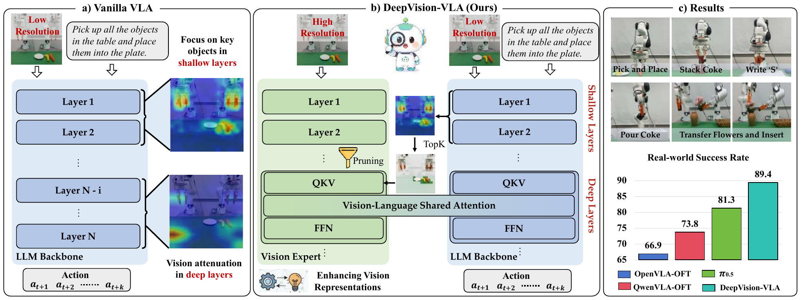
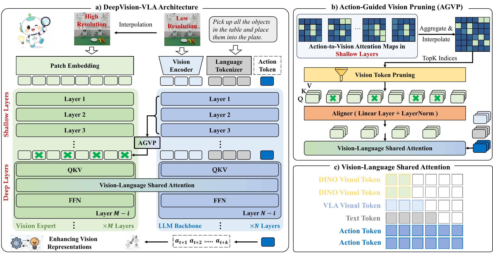

<div align="center">
  <h1>DeepVision-VLA</h1>
  <h3>Look Before Acting: Enhancing Vision Foundation Representations<br>for Vision-Language-Action Models</h3>
  <p><strong>ACM Multimedia 2026</strong></p>
  <p>Peking University · The Chinese University of Hong Kong · Simplexity Robotics</p>
  <p>
    <a href="https://arxiv.org/abs/2603.15618"></a>
    <a href="https://deepvision-vla.github.io/"></a>
    <a href="https://huggingface.co/lyl010221-pku/deepvision-vla-rlbench10"></a>
    <a href="https://doi.org/10.1145/3767308.3835774"></a>
    <a href="LICENSE"></a>
  </p>
  <p><a href="#overview">Overview</a> · <a href="#quick-start">Quick start</a> · <a href="#checkpoint">Checkpoint</a> · <a href="#evaluation">Evaluation</a> · <a href="#citation">Citation</a></p>
</div>

## 📰 News

- **2026.11.11** — Initial release of the inference code, RLBench-10 evaluation pipeline, and [RLBench-10 fine-tuned checkpoint](https://huggingface.co/lyl010221-pku/deepvision-vla-rlbench10).

Training code and embodied-pretraining checkpoints will follow.

<a name="overview"></a>

## 🔍 Overview

**Why do VLAs understand the instruction but still miss the object?** Visual information enters early, yet task-relevant evidence can become underused in the deep layers that generate actions. DeepVision-VLA brings high-resolution visual evidence back into those layers.

<p align="center">
  
</p>

- **Diagnose visual grounding.** Layer-wise ROI masking and attention analysis reveal where task-relevant visual evidence weakens.
- **VL-MoT: refresh deep visual evidence.** Couple multi-level DINOv3 features with the VLA backbone through shared attention while retaining separate processing pathways.
- **AGVP: keep action-relevant tokens.** Use shallow action-to-vision attention to select the high-resolution visual tokens passed to deep layers.

<p align="center">
  
</p>

This release provides **image inference and single-GPU RLBench-10 evaluation**. The figures above show results from the paper.

## 🧭 Start here

- **Set up the environment:** [Linux installation and simulator dependencies](docs/INSTALL_LINUX.md)
- **Get the model:** [Checkpoint download and verification](docs/CHECKPOINT_DELIVERY.md) · [Model card](docs/MODEL_CARD.md)
- **Predict an action:** [Image + instruction inference](docs/IMAGE_INFERENCE.md)
- **Run the benchmark:** [RLBench tasks, protocol and result summaries](docs/EVALUATION.md)
- **Explore the implementation:** [Source guide](docs/SOURCE_LAYOUT.md)

<a name="quick-start"></a>

## 🚀 Quick start

### 1. Install the environment

```bash
git clone https://github.com/yulin-luo/deepvision-vla.git
cd deepvision-vla
```

Follow [Linux installation](docs/INSTALL_LINUX.md) to create the environment and install the package. Simulator dependencies are needed only for RLBench evaluation. The commands below use `DV_WORK`, `DV_ASSETS`, and `DV_PY` from that guide.

The reference environment uses **Python 3.10.20, PyTorch 2.12.1 + CUDA 13.0, and Transformers 4.57.0**. Keep the source checkout: it includes the modified Transformers implementation used by the model.

```bash
"$DV_PY" -m deepvision_vla --help
```

### 2. Download the RLBench-10 checkpoint

```bash
"$DV_PY" -m deepvision_vla download \
  --output-root "$DV_ASSETS/rlbench10-model" \
  --cache "$DV_ASSETS/cache/huggingface"

export DV_CHECKPOINT="$DV_ASSETS/rlbench10-model/checkpoint-299-39300"
export DV_VERIFICATION="$DV_ASSETS/rlbench10-model/checkpoint_verification.json"
```

The command downloads and verifies the checkpoint. No Hugging Face login or separate base-model download is needed.

### 3. Configure image inference

For image inference alone, no PyRep, RLBench or CoppeliaSim directories are required:

```bash
"$DV_PY" -m deepvision_vla configure \
  --checkpoint "$DV_CHECKPOINT" \
  --verification-receipt "$DV_VERIFICATION" \
  --env-prefix "$DV_WORK/env" --image-only \
  --output "$DV_WORK/image-config.json"
```

For existing weights, see [how to reuse a checkpoint](docs/CHECKPOINT_DELIVERY.md#reuse-an-existing-checkpoint).

### 4. Run image inference

Create a request JSON beside an **uncropped 224 × 224 front-view RGB image**:

```json
{
  "schema_version": 1,
  "image": "input.png",
  "instruction": "close box"
}
```

Save the request as, for example, `$DV_WORK/request.json` and place `input.png` beside it. Select an available physical GPU:

```bash
"$DV_PY" -m deepvision_vla image \
  --config "$DV_WORK/image-config.json" \
  --request "$DV_WORK/request.json" \
  --task close_box --gpu 0 \
  --output "$DV_WORK/runs/image-001"
```

The prediction is saved to `results/image_prediction/prediction.json` under the run directory. It contains **XYZ delta, absolute XYZ Euler rotation, and gripper**. See [image inference](docs/IMAGE_INFERENCE.md) for the input and output formats.

Use a **new output directory** for every run.

<a name="checkpoint"></a>

## 🤗 Checkpoint

[**DeepVision-VLA RLBench-10**](https://huggingface.co/lyl010221-pku/deepvision-vla-rlbench10) is fine-tuned on RLBench-10 and ready for inference and evaluation.

[Download and setup](docs/CHECKPOINT_DELIVERY.md) · [Model specifications](docs/MODEL_CARD.md#model-specifications)

<a name="evaluation"></a>

## 🧪 RLBench evaluation

The evaluator supports **10 tasks**: closing a box, fridge and laptop; placing a phone and wine bottle; sweeping; taking a frame and umbrella; watering plants; and lowering a toilet seat. Exact task identifiers and the pinned protocol are listed in [the evaluation guide](docs/EVALUATION.md).

Before evaluating, complete the native-dependency section of [Linux installation](docs/INSTALL_LINUX.md), then generate a full configuration and check its libraries:

```bash
"$DV_PY" -m deepvision_vla configure \
  --checkpoint "$DV_CHECKPOINT" \
  --verification-receipt "$DV_VERIFICATION" \
  --env-prefix "$DV_WORK/env" --deps-root "$DV_WORK/deps" \
  --output "$DV_WORK/rlbench-config.json"

"$DV_PY" -m deepvision_vla doctor --config "$DV_WORK/rlbench-config.json"
```

`doctor` checks simulator libraries before evaluation. Use the full configuration above for RLBench; image-only configurations do not include simulator dependencies.

### One task

```bash
"$DV_PY" -m deepvision_vla eval \
  --config "$DV_WORK/rlbench-config.json" \
  --task close_box --episodes 50 --gpu 0 \
  --output "$DV_WORK/runs/close-box-001"
```

Use `--episodes 1` for a single-episode integration check. The protocol uses variation 0, front-view RGB, seed `42 + episode_id × 1009`, at most 10 policy steps, and one reset attempt per episode identity.

### Summarize saved results

```bash
"$DV_PY" -m deepvision_vla audit-rollouts \
  --output-root "$DV_WORK/runs/close-box-001" \
  --task close_box --episodes 50 \
  --receipt "$DV_WORK/runs/close-box-001-summary.json"
```

The summary reports requested episodes, actual attempts, successes, failures, and missing outcomes from the saved run.

### All ten tasks

```bash
"$DV_PY" -m deepvision_vla evaluate-all \
  --config "$DV_WORK/rlbench-config.json" --gpu 0 \
  --output "$DV_WORK/runs/rlbench10-001"
```

This runs 50 episodes per task, for 500 requests. Use a new output directory; partial results are marked incomplete.

## 🗂️ Repository structure

```text
deepvision-vla/
├── assets/                  # Paper overview and method figures
├── configs/                 # Example configuration
├── docs/                    # Installation, model and usage guides
├── src/deepvision_vla/
│   ├── inference/           # Image requests and prediction adapter
│   ├── evaluation/          # Task runner and result summaries
│   ├── runtime/             # Checkpoint loading, reset and headless display
│   ├── tools/               # Download, verification and setup
│   └── assets/              # Model inventory and runtime profiles
├── model_runtime/           # Model implementation and pinned dependencies
├── locks/                   # Exact Linux environment artifacts
├── licenses/                # Upstream licences
├── tests/                   # CPU regression tests
└── pyproject.toml
```

See [the source guide](docs/SOURCE_LAYOUT.md) for VL-MoT, AGVP and action-head implementation locations.

<a name="citation"></a>

## 📝 Citation

If you use DeepVision-VLA in your research, please cite the ACM Multimedia paper:

```bibtex
@inproceedings{luo2026deepvision,
  title = {Look Before Acting: Enhancing Vision Foundation Representations for Vision-Language-Action Models},
  author = {Luo, Yulin and Chen, Hao and Wu, Zhuangzhe and Sui, Bowen and Liu, Jiaming and Gu, Chenyang and Liu, Zhuoyang and Jia, Peng and Heng, Pheng-Ann and Zhang, Shanghang},
  booktitle = {Proceedings of the 34th ACM International Conference on Multimedia},
  year = {2026},
  doi = {10.1145/3767308.3835774}
}
```

## 📜 Licence and acknowledgements

The source code is distributed under [Apache 2.0](LICENSE), with the applicable upstream notices preserved. Qwen-derived weights, DINOv3-derived weights, RLBench and CoppeliaSim retain their respective terms; see [third-party notices](THIRD_PARTY_NOTICES.md).

We thank the authors of [Qwen3-VL](https://github.com/QwenLM/Qwen3-VL), [DINOv3](https://github.com/facebookresearch/dinov3), [OpenVLA](https://github.com/openvla/openvla), [OpenVLA-OFT](https://github.com/moojink/openvla-oft), and [LIFT3D](https://github.com/PKU-HMI-Lab/LIFT3D) for their open-source contributions.
