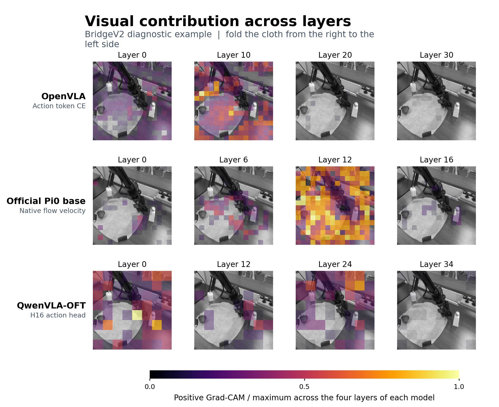

# BridgeData V2 contribution maps


[Figure 2 from the paper](https://arxiv.org/html/2603.15618v1#S3.SS2) · [Full-resolution figure](../../assets/bridgev2-paper-figure2.png)

## Runnable attribution example

The maps below use one cloth-folding frame and the published checkpoints. [Recompute all three models from the source frame](../../docs/diagnostics/ATTRIBUTION.md).



[Three-model PDF](native-attribution.pdf) · [Render manifest](NATIVE_RENDER_RECEIPT.json)

This example contains the original image and the signed and positive token Grad-CAM values for four layers of each model. All three models read the same BridgeData V2 frame and the instruction “fold the cloth from the right to the left side.”

- OpenVLA layers 0, 10, 20, and 30 use cross-entropy on the model's generated action tokens.
- Official LeRobot π₀ base layers 0, 6, 12, and 16 use the mean squared native flow velocity at a fixed denoising step.
- QwenVLA-OFT layers 0, 12, 24, and 34 use the mean squared output of the full normalized H16 action head.

The figure divides the positive Grad-CAM values by the maximum across the four layers of each model. The maps describe this one example. The models use different attribution targets and the plot scale is shared only within each model.

## Redraw

Run from the repository root with Python 3.12 and uv. The plotting environment is
pinned in `requirements/diagnostics-analysis.txt`.

```bash
uv venv --python 3.12 .venv-bridgev2-plot
uv pip install --python .venv-bridgev2-plot/bin/python -r requirements/diagnostics-analysis.txt
export PYTHONPATH="$PWD/src"
EXAMPLE_DIR="$PWD/examples/bridgev2-attribution"
FIGURE_DIR="$PWD/bridgev2-attribution-redraw"
(cd "$EXAMPLE_DIR" && sha256sum -c SHA256SUMS)
.venv-bridgev2-plot/bin/python -m deepvision_vla.diagnostics plot attribution \
  --image "$EXAMPLE_DIR/source.jpg" \
  --result "$EXAMPLE_DIR/openvla.json" \
  --result "$EXAMPLE_DIR/pi0-base.json" \
  --result "$EXAMPLE_DIR/qwen-h16-public.json" \
  --output "$FIGURE_DIR"
```

For the per-layer min–max view, run the same command with `--scale layer` and a
new output directory. This version shows where positive contribution is located
within each map. Use the shared-scale view to compare strengths across a
model's layers.

The output contains `attribution.png`, `attribution.pdf`, and `RENDER_RECEIPT.json`. The frame locator and image digest are in `source.json`.
For a new QwenVLA-OFT Grad-CAM probe, see the [Qwen H16 guide](../../docs/diagnostics/QWEN_H16_ENVIRONMENT.md).

## Image credit

The source frame is from *BridgeData V2: A Dataset for Robot Learning at Scale*, Homer Walke and collaborators, CoRL 2023. `source.jpg` is the reconstructed input frame. The figure displays it in grayscale with DeepVision-VLA diagnostic overlays. [BridgeData V2](https://rail-berkeley.github.io/bridgedata/) · [CC BY 4.0](https://creativecommons.org/licenses/by/4.0/)
